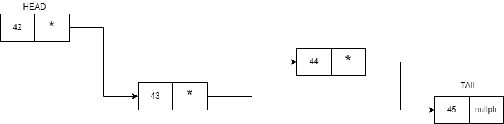
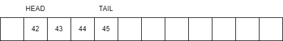

# Опашка

Опашката е линейна структура от данни, която работи на принципа FIFO (first in first out). Опашката отговаря точно на представата за реална опашка. 
Операции:
* Enqueue (или push) - добавя елемент в края на опашката
* Dequeue (или pop)  - премахва първия добавен елемент в опашката
* Front              - връща първия елемент в опашката
  
Опционални операции към интерфейса:
* empty() - Връща дали опашката е празна или не
* size()  - Връща размера на опашката

В STL имаме готова реализация на опашка. Тя се намира в библиотеката \<queue> и се създава чрез std::queue\<T>. 
Пример:
```cpp
#include<iostream>
#include<queue>

int main() {
    std::queue<int> q;

    q.push(1);
    q.push(2);
    q.push(3);
    q.push(4);

    std::cout << q.front();             // Извежда 1
    q.pop();                            // Премахва 1 от опашката
    std::cout << q.front();             // Извежда 2
    q.pop();                            // Премахва 2 от опашката
    q.pop();                            // Премахва 3 от опашката
}
```

## Приложения
Едно от основните приложения на опашката е използването ѝ в различни алгоритми за обхождане на графи, като най-ясен пример за това би бил алгоритъма BFS. Други алгоритми върху графи също използват опашка (или нейни разновидности) за да обхождат графа и да решават различни задачи върху него. 
Опашките също намират голямо приложение в операционните системи и компютърните мрежи.

## Начини за реализация
### Чрез свързан списък

Представяме елемента на опашката по следния начин:
```cpp
template<class T>
struct QueueNode {
    T data;
    QueueNode<T>* next;
};
```
В класа представящ опашка пазим два указателя, head и tail:
```cpp
template<class T>
class LinkedQueue {
    QueueNode<T>* head;                 // Представлява първия елемент, който е добавен.
    QueueNode<T>* tail;                 // Представлява последния елемент, който е добавен.
};
```

При такова представяне как биха изглеждали алгоритмите за добавяне и премахване?

### Чрез масив
Можем да представим опашката чрез статичен или динамичен масив и два индекса - към първия  и последния елемент добавен към опашката.


При такова представяне как биха изглеждали алгоритмите за добавяне и премахване? Дали след като запълним последната клетка на масива повече няма да можем да добавим елемент в опашката?

## Дек (двустранна опашка)
Декът (deque - double-ended queue) е разновидност на опашката, при която можем да добавяме и премахваме елементи и от двата края за O(1).
Операции:
* push_front / push_back - добавя елемент в началото / края
* pop_front / pop_back   - премахва елемента в началото / края
* front / back           - връща елемента в началото / края

В STL декът се намира в библиотеката \<deque> и се създава чрез std::deque\<T>. Всъщност std::queue по подразбиране използва std::deque като вътрешен контейнер.
Пример:
```cpp
#include<iostream>
#include<deque>

int main() {
    std::deque<int> dq;

    dq.push_back(2);                    // 2
    dq.push_back(3);                    // 2 3
    dq.push_front(1);                   // 1 2 3

    std::cout << dq.front();            // Извежда 1
    std::cout << dq.back();             // Извежда 3

    dq.pop_back();                      // 1 2
    dq.pop_front();                     // 2
}
```

# Неща, които използвам в решението на задачите

## Статични масиви и std::array
Всички знаем, че статичният масив е бърза и удобна структура от данни. STL ни предлага готова реализация на статичен масив. Тя се намира в библиотеката \<array>.
Пример:
```cpp
#include<array>

int main() {
    std::array<int, 10> arr;
    arr[0] = 42;
}
```
В случая arr се държи като нормален статичен масив, но идва с допълнителни помощни функции и поддържа логика за итератори.

## Нетипови параметри
Нетиповите параметри често се използват за определяне на някакви максимуми, минимуми или константи свързани с класа. Примерно, нека имаме следния код:

```cpp
const size_t MAX_SIZE = 100;

template<class T>
class staticArray {
    T data[MAX_SIZE];
};
```
Това върши работа до момента, в който не ни потрябват два различни варианта на staticArray - един с максимум 100 елемента, а втория с максимум 50. Този проблем се решава чрез нетипови параметри по следния начин:
```cpp
template<class T, size_t maxSize>
class staticArray {
    T data[maxSize];
};
```
Сега много лесно мога да си направя два статични масива с различна горна граница:

```cpp
int main() {
    staticArray<int, 50> fst;
    staticArray<int, 100> snd;
}
```
Стойността на нетиповия параметър трябва да е известна по време на компилация (константа), затова `T data[maxSize]` е валиден статичен масив.
Едно хубаво свойство на нетиповите параметри е, че `staticArray<T, 50>` и `staticArray<T, 100>` са два различни типа.

# Задачи

## Задача 1
Да се напише функция, която генерира всички двоични числа от 1 до n, използвайки опашка.

Пример:
> n = 10 ➡ 1 10 11 100 101 110 111 1000 1001 1010

## Задача 2
Конче стои върху шахматна дъска NxN. За начална и крайна позиция да се изведе с колко най-малко хода можем да стигнем от началната до крайната.

Пример:
> {(0, 0), (2, 1)} -> 1
> 
> {(0, 0), (7, 7)} -> 6


Като бонус можете да направите втора задача да не извежда само минималния път, но и клетките през които сме минали.

## Задача 3
Напишете функция, която приема масив от цели числа и проверява дали подредицата, съставена само от положителните числа в масива е същата като подредицата, съставена от отрицателните числа в масива (след умножаването на всички числа в едната подредица с -1).  
**Да се реши чрез опашка!**  

*Вход: 1 5 -1 4 -5 9 8 -4 -9 18 -8 -18 -7 7, Изход: true  
Вход: 1 -1 2 -2 3 3, Изход: false*  

## Задача 4
Да се реализира клас MovingAverage, който получава поток от цели числа и изчислява средното аритметично на последните k числа (плъзгащ прозорец с размер k).
* MovingAverage(size_t k) - създава обект с размер на прозореца k
* double next(int value)  - добавя value към потока и връща средното аритметично на последните k числа (или на всички числа до момента, ако те са по-малко от k)

Всяко извикване на next трябва да работи за O(1).  
**Да се реши чрез опашка!**

Пример:
> k = 3
>
> next(1) -> 1 (1 / 1)
>
> next(10) -> 5.5 ((1 + 10) / 2)
>
> next(3) -> 4.66667 ((1 + 10 + 3) / 3)
>
> next(5) -> 6 ((10 + 3 + 5) / 3)

## Задача 5
Даден е масив от цели числа и число k. Прозорец с размер k се плъзга по масива отляво надясно, като на всяка стъпка се измества с една позиция. Да се изведе максималният елемент във всеки прозорец.  
Решението трябва да е със сложност O(n).  
**Да се реши чрез дек!**

Пример:
> Вход: [1, 3, -1, -3, 5, 3, 6, 7], k = 3 ➡ Изход: [3, 3, 5, 5, 6, 7]
>
> Вход: [4, 2, 12, 3], k = 1 ➡ Изход: [4, 2, 12, 3]

Подсказка: пазете в дека индексите на елементите от текущия прозорец така, че стойностите им да са в намаляващ ред. Тогава максимумът винаги е в началото на дека.
